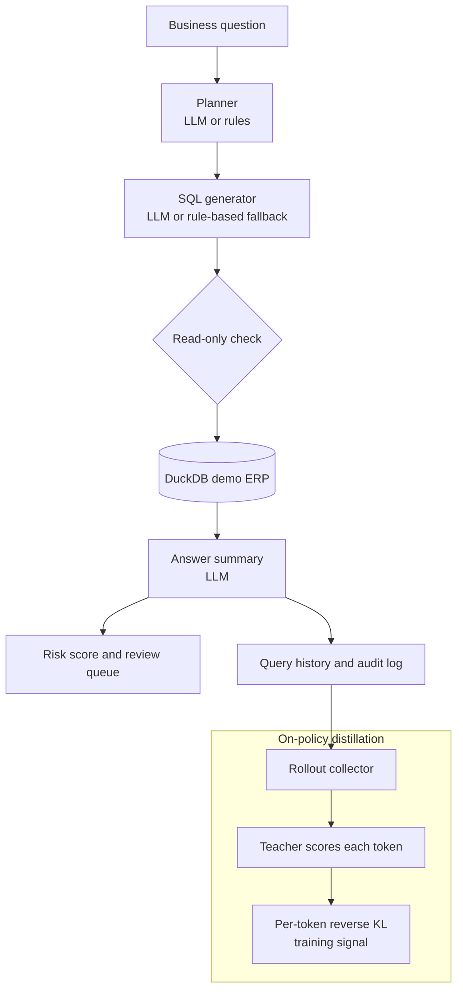

# Sputnik

Sputnik answers plain-English business questions over an ERP database by planning the question, generating read-only SQL, running it and summarizing the result, and records each run so a model can later be trained on its own usage.

## Why

Revenue, orders, invoices and inventory all live in the ERP, but getting a simple number out of it usually means asking an analyst who knows the schema and writes SQL. Letting a language model write that SQL is tempting, and also risky: it can invent tables, return a confident wrong answer, or run a statement that changes data. Sputnik is an early attempt at a careful layer in between: keep queries read-only, attach a risk score and a review queue to every answer, log who asked what, and collect rollouts so the model can be improved with on-policy distillation instead of sparse right-or-wrong rewards.

## What it does

- Takes a question in plain English, plans the steps, and generates SQL against the database schema with an LLM (Ollama or OpenRouter), falling back to rule-based SQL when no model is available.
- Checks generated SQL for write statements (`INSERT`, `UPDATE`, `DELETE`, `DROP`, `CREATE`, `ALTER`, `TRUNCATE`) before running it on DuckDB.
- Summarizes the result rows into an answer and stores the question, SQL, answer and timing in a query history.
- Scores each answer for risk from its confidence, and lets reviewers approve, edit, reject or escalate answers.
- Provides role-based access control, session management and an audit log through a FastAPI REST API.
- Collects agent rollouts and computes a per-token reverse KL training signal against a teacher model (the distillation step itself is still a skeleton, see Status).

## How it works



On-policy distillation: the student agent produces a trajectory of tokens and tool calls, a teacher model assigns a log probability to each token, and the training signal is `reverse_kl = student_logprob - teacher_logprob` per token. A dense per-token signal is expected to learn faster and more stably than a single reward at the end of the answer. See [docs/TECHNICAL.md](docs/TECHNICAL.md).

## Status

Alpha, built solo, and not ready for production data. Things to know before trying it:

- The web UI is kept in a separate repository; `frontend/` here is only a pointer to it, so a fresh clone has no UI.
- The DuckDB environment module (`src/sputnik/env/`) is currently excluded by an `env/` rule in `.gitignore`, so the API server and `run_demo.py` will not start from a fresh clone until it is added.
- The read-only check is a keyword check on the generated SQL; the step meant to rewrite an unsafe query (`_make_read_only`) is a stub.
- The distillation trainer uses a mock teacher and computes the training signal and metrics, but does not update model weights yet. `scripts/run_eval.py` also runs on two mock examples.

## Quick start

Python 3.11+.

```bash
git clone https://github.com/stanislavli3/sputnik.git
cd sputnik
pip install -e ".[dev]"
python scripts/setup_demo_db.py      # demo ERP: customers, orders, invoices, inventory_movements
```

### LLM (optional)

**Ollama (local)**
```bash
ollama pull llama3
export LLM_PROVIDER=ollama
export LLM_MODEL=llama3
```

**OpenRouter (cloud)**
```bash
export LLM_PROVIDER=openrouter
export LLM_MODEL=meta-llama/llama-3-8b-instruct
export LLM_API_KEY=your_api_key_here
```

**No LLM (rule-based fallback)**
```bash
export USE_LLM_PLANNING=false
export USE_LLM_SQL=false
```

See [docs/LLM_SETUP.md](docs/LLM_SETUP.md) for details.

### Run

```bash
python scripts/start_server.py            # API on http://localhost:8000, docs at /docs
# or
uvicorn sputnik.api.server:app --reload
```

Individual components:

```bash
python scripts/run_demo.py                # interactive CLI demo
python scripts/run_eval.py                # evaluation (mock examples for now)
python scripts/run_on_policy_distill.py   # distillation loop on mock rollouts
```

Development commands are in the `Makefile` (`make help`); tests run with `pytest tests/`.

## API

All routes are under `/api/v1`. Main groups:

| Group | Examples |
|---|---|
| Query | `POST /query`, `GET /queries/history`, `GET /queries/{id}/export` |
| Review and risk | `GET /reviews`, `POST /reviews/{id}/approve`, `GET /query/{id}/risk`, `POST /query/{id}/escalate` |
| Learning | `GET /rollouts`, `POST /rollouts/train`, `GET /metrics/overview` |
| Schema and models | `GET /schema`, `GET /models`, `POST /models/select` |
| Access | `GET /users/me/roles`, `POST /users/roles/assign`, `GET /sessions/me`, `GET /audit/logs` |

Authentication uses Clerk JWTs; see [docs/AUTHENTICATION.md](docs/AUTHENTICATION.md).

## Project layout

```
sputnik/
├── src/sputnik/
│   ├── agent/        # planner, SQL generator, tool router
│   ├── api/          # FastAPI server, routes, RBAC, audit, sessions, risk, history DB
│   ├── distill/      # rollout collector, teacher, reverse KL, trainer
│   ├── eval/         # evaluation runner and metrics
│   ├── llm/          # Ollama and OpenRouter clients
│   └── types.py
├── scripts/          # demo DB setup, server, demo, eval, distillation
├── tests/
└── docs/             # technical, connectors, safety, auth, development, LLM setup
```

## Roadmap

- [x] Core architecture and types
- [x] DuckDB connector for demos
- [x] LLM integration (Ollama and OpenRouter)
- [x] Audit logging, RBAC, session management
- [x] On-policy distillation skeleton and evaluation framework
- [ ] Weight updates with a real teacher and student
- [ ] Odoo and NetSuite connectors
- [ ] PII detection and masking
- [ ] Multi-tenant support

## Results

No accuracy results yet. The evaluation and distillation scripts currently run on mock components, so there are no numbers worth reporting.

## Documentation

- [Technical details](docs/TECHNICAL.md): on-policy distillation
- [Connectors](docs/CONNECTORS.md): ERP connector design
- [Safety](docs/SAFETY.md): safety features
- [Authentication](docs/AUTHENTICATION.md): Clerk setup
- [Development](docs/DEVELOPMENT.md): development workflow
- [Contributing](CONTRIBUTING.md)

## License

MIT. See [LICENSE](LICENSE).
